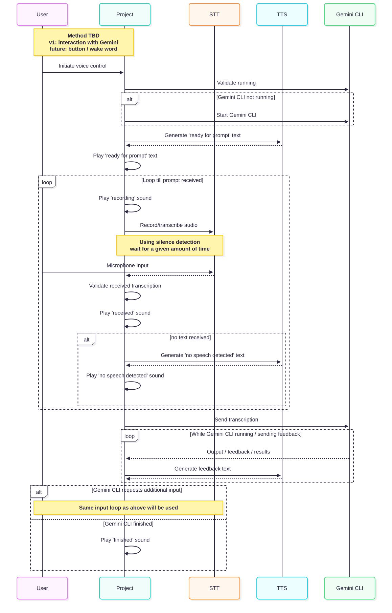

Recent AI innovations, more specifically new agentic workflows and the open-source [Gemini CLI](https://github.com/google-gemini/gemini-cli), inspired me to modernize my [Smart Home Display](/2021-01-06-smart-home-display/). The vision is that anyone in my home will be able to voice control what the smart screen shows, without being limited to its current capabilities. If someone wants it to show an image of a Pokémon, or the current stock value of Microsoft, the screen should be able to create the necessary code on the fly.

The device doesn't have a connected mouse, keyboard or active screen aside from the e-Paper display. Due to this I really want to enable a full headless interaction model, where everything works with voice alone. Initial attempts to achieve this made use of MCP servers like [voice-mode](https://getvoicemode.com/) and the built-in operating system accessibility features. These approaches did not offer the necessary UX or control needed to actually make this useful so in the end I decided to build my own tool.

The remainder of this blog post will focus on this 'voice vibe tool' but it is worth mentioning that I also did make some general changes to my smart screen code to setup AI for success on my code. Modules were re-architected in such a way that there is a very clear distinction between data providers and display modules. Some parts were cleaned up and documentation was added, including Gemini instructions, to the source code. All of this should help facilitate an AI to deliver when needed.

# Sequence Diagram

To achieve the project goal as described above we can translate the desired behaviour in a sequence diagram. There are some key components we know we'll need.

- a Speech-to-Text (STT) system in order to input commands and text into our project and Gemini CLI. I'm using a [custom fork](https://github.com/msioen/whisper.cpp) of the open-source [whisper.cpp](https://github.com/ggml-org/whisper.cpp) project.
- a Text-to-Speech (TTS) system in order to provide the needed feedback back to the user. I'm using a local implementation of the [Kokoro-TTS](https://huggingface.co/spaces/hexgrad/Kokoro-TTS) model.

The below diagram shows the key (voice) interactions between all components. For simplicity some use cases have been omitted from the diagram, for example approval requests for tool execution.

# Interacting with Gemini CLI

A key part of the project is interaction with the Gemini CLI itself. We need to be informed about what is happening or if any input is required. On the other hand we also need to be able to provide the actual input back to the system. One option would be to run in a fully non-interactive, yolo mode but this kind of defeats the purpose.

My initial hope was to build this completely without needing to make any changes to Gemini CLI itself. I validated approaches by fully self-managing the process and trying to manipulate the input/output streams. This proved unsuccessful. As a second promising input hook I validated creating my own OpenTelemetry Collector and hooking into the existing telemetry system. This also didn't cover all the necessary events.

In the end I did end up making some relatively small changes in [my own fork](https://github.com/msioen/gemini-cli) of gemini-cli. This way I was able to add some needed additional events, mainly for input events. I added a hook when gemini-cli requests new input and whenever permission is requested to the user.

For the feedback loop back to Gemini CLI I'm currently using some simple AppleScript file. As my end goal is to get this running on a Raspberry Pi this is one of the key areas I have to revisit but it works a charm on macOS.

# Demo Time

Below you can find some example videos of the project working. All of the input/output was done using voice. Just like my intended end use case, these examples would have worked on a machine without a keyboard, mouse or screen attached.

You'll notice that there are some improvement areas with regards to how much feedback Gemini gives during the process but while very verbose it does work very nice.

<iframe width="750" height="422" src="https://www.youtube.com/embed/aTw-XeOX674?si=hM54AyN3g6Oe0GRk" title="YouTube video player" frameborder="0" allow="accelerometer; autoplay; clipboard-write; encrypted-media; gyroscope; picture-in-picture; web-share" referrerpolicy="strict-origin-when-cross-origin" allowfullscreen></iframe>

<iframe width="750" height="422" src="https://www.youtube.com/embed/KY9q0lafJ2Q?si=8NYBr2AgTpTWcOK3" title="YouTube video player" frameborder="0" allow="accelerometer; autoplay; clipboard-write; encrypted-media; gyroscope; picture-in-picture; web-share" referrerpolicy="strict-origin-when-cross-origin" allowfullscreen></iframe>

 
All source code for this project is available on GitHub: [https://github.com/msioen/gemini-cli-voice](https://github.com/msioen/gemini-cli-voice).

 
 
